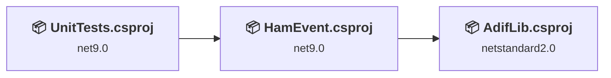
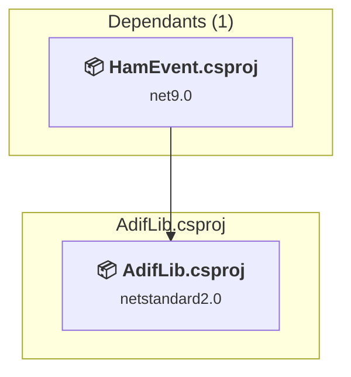
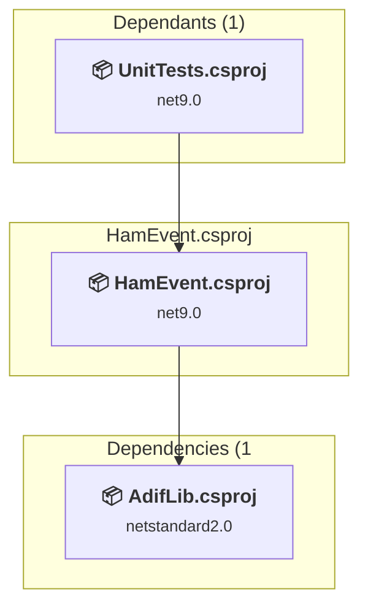
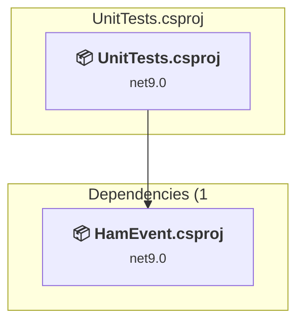

# Projects and dependencies analysis

This document provides a comprehensive overview of the projects and their dependencies in the context of upgrading to .NETCoreApp,Version=v10.0.

## Table of Contents

- [Executive Summary](#executive-Summary)
  - [Highlevel Metrics](#highlevel-metrics)
  - [Projects Compatibility](#projects-compatibility)
  - [Package Compatibility](#package-compatibility)
  - [API Compatibility](#api-compatibility)
  - [Binding Redirect Configuration](#binding-redirect-configuration)
- [Aggregate NuGet packages details](#aggregate-nuget-packages-details)
- [Top API Migration Challenges](#top-api-migration-challenges)
  - [Technologies and Features](#technologies-and-features)
  - [Most Frequent API Issues](#most-frequent-api-issues)
- [Projects Relationship Graph](#projects-relationship-graph)
- [Project Details](#project-details)

  - [AdifLib\AdifLib\AdifLib.csproj](#adiflibadiflibadiflibcsproj)
  - [HamEvent\HamEvent.csproj](#hameventhameventcsproj)
  - [UnitTests\UnitTests.csproj](#unittestsunittestscsproj)

## Executive Summary

### Highlevel Metrics

| Metric | Count | Status |
| :--- | :---: | :--- |
| Total Projects | 3 | 2 require upgrade |
| Total NuGet Packages | 22 | 8 need upgrade |
| Total Code Files | 50 |  |
| Total Code Files with Incidents | 6 |  |
| Total Lines of Code | 4895 |  |
| Total Number of Issues | 22 |  |
| Estimated LOC to modify | 11+ | at least 0.2% of codebase |

### Projects Compatibility

| Project | Target Framework | Difficulty | Package Issues | API Issues | Binding Issues | Est. LOC Impact | Description |
| :--- | :---: | :---: | :---: | :---: | :---: | :---: | :--- |
| [AdifLib\AdifLib\AdifLib.csproj](#adiflibadiflibadiflibcsproj) | netstandard2.0 | ✅ None | 0 | 0 | 0 |  | ClassLibrary, Sdk Style = True |
| [HamEvent\HamEvent.csproj](#hameventhameventcsproj) | net9.0 | 🟢 Low | 5 | 3 | 0 | 3+ | AspNetCore, Sdk Style = True |
| [UnitTests\UnitTests.csproj](#unittestsunittestscsproj) | net9.0 | 🟢 Low | 4 | 8 | 0 | 8+ | DotNetCoreApp, Sdk Style = True |

### Package Compatibility

| Status | Count | Percentage |
| :--- | :---: | :---: |
| ✅ Compatible | 14 | 63.6% |
| ⚠️ Incompatible | 1 | 4.5% |
| 🔄 Upgrade Recommended | 7 | 31.8% |
| ***Total NuGet Packages*** | ***22*** | ***100%*** |

### API Compatibility

| Category | Count | Impact |
| :--- | :---: | :--- |
| 🔴 Binary Incompatible | 1 | High - Require code changes |
| 🟡 Source Incompatible | 2 | Medium - Needs re-compilation and potential conflicting API error fixing |
| 🔵 Behavioral change | 8 | Low - Behavioral changes that may require testing at runtime |
| ✅ Compatible | 8619 |  |
| ***Total APIs Analyzed*** | ***8630*** |  |

## Aggregate NuGet packages details

| Package | Current Version | Suggested Version | Projects | Description |
| :--- | :---: | :---: | :--- | :--- |
| coverlet.collector | 8.0.1 |  | [UnitTests.csproj](#unittestsunittestscsproj) | ✅Compatible |
| elmahcore | 2.1.2 |  | [HamEvent.csproj](#hameventhameventcsproj) | ✅Compatible |
| MailKit | 4.18.1 |  | [HamEvent.csproj](#hameventhameventcsproj) | ✅Compatible |
| Mapster | 7.4.0 |  | [HamEvent.csproj](#hameventhameventcsproj) | ✅Compatible |
| Microsoft.AspNetCore.Mvc.Testing | 9.0.21 | 10.0.13 | [UnitTests.csproj](#unittestsunittestscsproj) | NuGet package upgrade is recommended |
| Microsoft.AspNetCore.SpaProxy | 9.0.21 | 10.0.13 | [HamEvent.csproj](#hameventhameventcsproj) | NuGet package upgrade is recommended |
| Microsoft.EntityFrameworkCore | 9.0.21 | 10.0.13 | [HamEvent.csproj](#hameventhameventcsproj) | NuGet package upgrade is recommended |
| Microsoft.EntityFrameworkCore.InMemory | 9.0.21 | 10.0.13 | [UnitTests.csproj](#unittestsunittestscsproj) | NuGet package upgrade is recommended |
| Microsoft.EntityFrameworkCore.Sqlite | 9.0.21 | 10.0.13 | [HamEvent.csproj](#hameventhameventcsproj) | NuGet package upgrade is recommended |
| Microsoft.EntityFrameworkCore.Tools | 9.0.21 | 10.0.13 | [HamEvent.csproj](#hameventhameventcsproj) | NuGet package upgrade is recommended |
| Microsoft.NET.Test.Sdk | 18.0.1 |  | [UnitTests.csproj](#unittestsunittestscsproj) | ✅Compatible |
| Moq | 4.20.72 |  | [UnitTests.csproj](#unittestsunittestscsproj) | ✅Compatible |
| Moq.EntityFrameworkCore | 9.0.0.10 |  | [UnitTests.csproj](#unittestsunittestscsproj) | ✅Compatible |
| NETStandard.Library | 2.0.3 |  | [AdifLib.csproj](#adiflibadiflibadiflibcsproj) | ✅Compatible |
| Newtonsoft.Json | 13.0.4 |  | [HamEvent.csproj](#hameventhameventcsproj) | ✅Compatible |
| NReco.Logging.File | 1.3.1 |  | [HamEvent.csproj](#hameventhameventcsproj) | ✅Compatible |
| Select.HtmlToPdf.NetCore | 25.2.0 |  | [HamEvent.csproj](#hameventhameventcsproj) | ✅Compatible |
| System.Configuration.ConfigurationManager | 9.0.21 | 10.0.13 | [HamEvent.csproj](#hameventhameventcsproj) | NuGet package upgrade is recommended |
| System.Data.SqlClient | 4.9.1 |  | [HamEvent.csproj](#hameventhameventcsproj) [UnitTests.csproj](#unittestsunittestscsproj) | ✅Compatible |
| System.Text.RegularExpressions | 4.3.1 |  | [UnitTests.csproj](#unittestsunittestscsproj) | NuGet package functionality is included with framework reference |
| xunit | 2.9.3 |  | [UnitTests.csproj](#unittestsunittestscsproj) | ⚠️NuGet package is deprecated |
| xunit.runner.visualstudio | 3.1.5 |  | [UnitTests.csproj](#unittestsunittestscsproj) | ✅Compatible |

## Top API Migration Challenges

### Technologies and Features

| Technology | Issues | Percentage | Migration Path |
| :--- | :---: | :---: | :--- |
| Legacy Configuration System | 2 | 18.2% | Legacy XML-based configuration system (app.config/web.config) that has been replaced by a more flexible configuration model in .NET Core. The old system was rigid and XML-based. Migrate to Microsoft.Extensions.Configuration with JSON/environment variables; use System.Configuration.ConfigurationManager NuGet package as interim bridge if needed. |

### Most Frequent API Issues

| API | Count | Percentage | Category |
| :--- | :---: | :---: | :--- |
| T:System.Text.Json.JsonDocument | 4 | 36.4% | Behavioral Change |
| T:System.Net.Http.HttpContent | 2 | 18.2% | Behavioral Change |
| T:System.Configuration.ConfigurationErrorsException | 1 | 9.1% | Source Incompatible |
| M:System.Configuration.ConfigurationErrorsException.#ctor(System.String) | 1 | 9.1% | Source Incompatible |
| M:Microsoft.Extensions.DependencyInjection.OptionsConfigurationServiceCollectionExtensions.Configure''1(Microsoft.Extensions.DependencyInjection.IServiceCollection,Microsoft.Extensions.Configuration.IConfiguration) | 1 | 9.1% | Binary Incompatible |
| T:System.Uri | 1 | 9.1% | Behavioral Change |
| M:System.Uri.#ctor(System.String) | 1 | 9.1% | Behavioral Change |

## Projects Relationship Graph

Legend:
📦 SDK-style project
⚙️ Classic project

## Project Details

### AdifLib\AdifLib\AdifLib.csproj

#### Project Info

- **Current Target Framework:** netstandard2.0✅
- **SDK-style**: True
- **Project Kind:** ClassLibrary
- **Dependencies**: 0
- **Dependants**: 1
- **Number of Files**: 4
- **Lines of Code**: 446
- **Estimated LOC to modify**: 0+ (at least 0.0% of the project)

#### Dependency Graph

Legend:
📦 SDK-style project
⚙️ Classic project

### API Compatibility

| Category | Count | Impact |
| :--- | :---: | :--- |
| 🔴 Binary Incompatible | 0 | High - Require code changes |
| 🟡 Source Incompatible | 0 | Medium - Needs re-compilation and potential conflicting API error fixing |
| 🔵 Behavioral change | 0 | Low - Behavioral changes that may require testing at runtime |
| ✅ Compatible | 446 |  |
| ***Total APIs Analyzed*** | ***446*** |  |

### HamEvent\HamEvent.csproj

#### Project Info

- **Current Target Framework:** net9.0
- **Proposed Target Framework:** net10.0
- **SDK-style**: True
- **Project Kind:** AspNetCore
- **Dependencies**: 1
- **Dependants**: 1
- **Number of Files**: 61
- **Number of Files with Incidents**: 2
- **Lines of Code**: 3036
- **Estimated LOC to modify**: 3+ (at least 0.1% of the project)

#### Dependency Graph

Legend:
📦 SDK-style project
⚙️ Classic project

### API Compatibility

| Category | Count | Impact |
| :--- | :---: | :--- |
| 🔴 Binary Incompatible | 1 | High - Require code changes |
| 🟡 Source Incompatible | 2 | Medium - Needs re-compilation and potential conflicting API error fixing |
| 🔵 Behavioral change | 0 | Low - Behavioral changes that may require testing at runtime |
| ✅ Compatible | 4701 |  |
| ***Total APIs Analyzed*** | ***4704*** |  |

#### Project Technologies and Features

| Technology | Issues | Percentage | Migration Path |
| :--- | :---: | :---: | :--- |
| Legacy Configuration System | 2 | 66.7% | Legacy XML-based configuration system (app.config/web.config) that has been replaced by a more flexible configuration model in .NET Core. The old system was rigid and XML-based. Migrate to Microsoft.Extensions.Configuration with JSON/environment variables; use System.Configuration.ConfigurationManager NuGet package as interim bridge if needed. |

### UnitTests\UnitTests.csproj

#### Project Info

- **Current Target Framework:** net9.0
- **Proposed Target Framework:** net10.0
- **SDK-style**: True
- **Project Kind:** DotNetCoreApp
- **Dependencies**: 1
- **Dependants**: 0
- **Number of Files**: 9
- **Number of Files with Incidents**: 4
- **Lines of Code**: 1413
- **Estimated LOC to modify**: 8+ (at least 0.6% of the project)

#### Dependency Graph

Legend:
📦 SDK-style project
⚙️ Classic project

### API Compatibility

| Category | Count | Impact |
| :--- | :---: | :--- |
| 🔴 Binary Incompatible | 0 | High - Require code changes |
| 🟡 Source Incompatible | 0 | Medium - Needs re-compilation and potential conflicting API error fixing |
| 🔵 Behavioral change | 8 | Low - Behavioral changes that may require testing at runtime |
| ✅ Compatible | 3472 |  |
| ***Total APIs Analyzed*** | ***3480*** |  |

